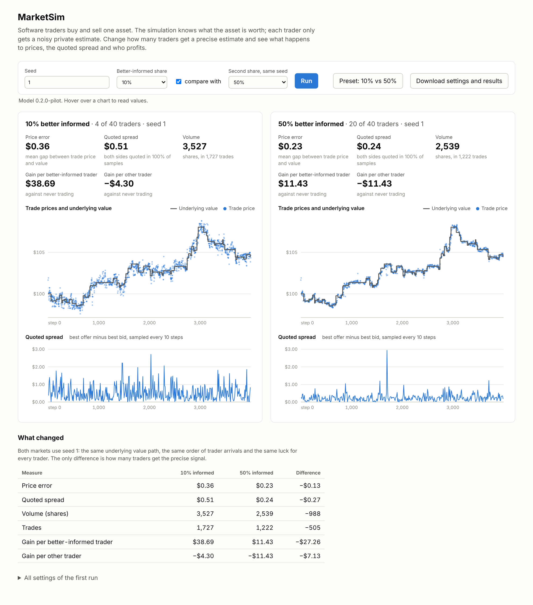
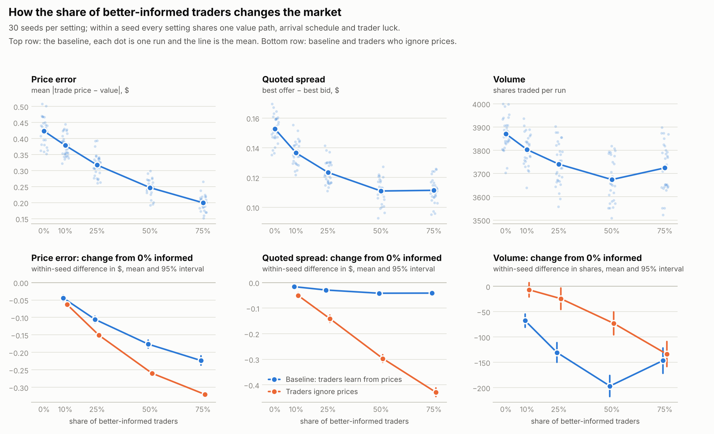
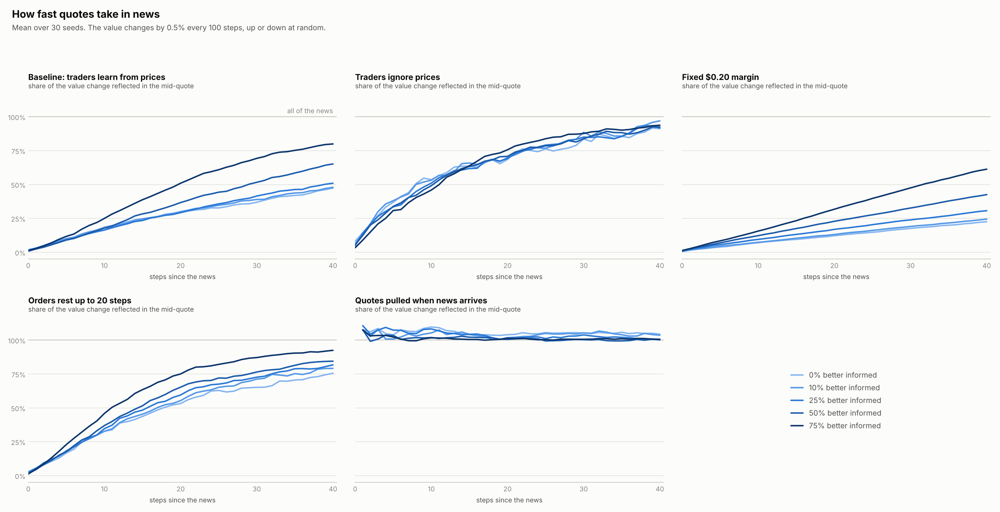
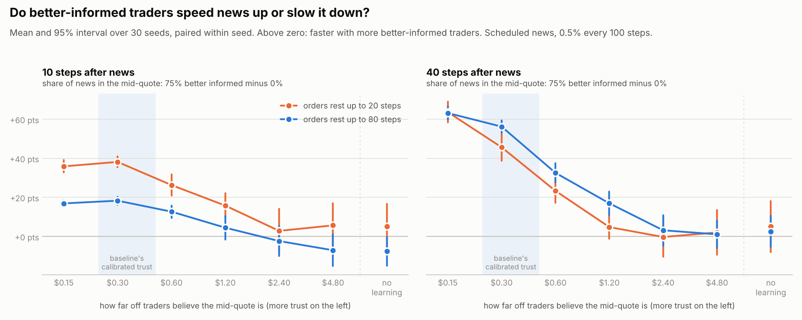

# MarketSimR


An artificial exchange where software traders buy and sell one asset. The simulation knows
the asset's underlying value. Each trader gets only a noisy private estimate of it, decides
what price it will accept, and sends an order to a limit order book. Comparing the prices
that result with the underlying value shows how information reaches a market.

**The question:** how does the proportion of better-informed traders affect price
accuracy, liquidity and trader profits?



The same market run twice on one seed: with 10% of traders well informed (left) trade
prices scatter around the underlying value, and with 50% (right) they hug it. (Screenshot
taken under the pilot rules.)

> **Status: model 1.0.0, configuration frozen on 2026-11-17.** The engine, market model,
> four saved experiments, a theory benchmark and a local dashboard run and are tested, and
> GitHub reinstalls and rechecks everything on each push. The pilot that led to this
> configuration is kept at git tag `pilot-0.2.0`. [docs/STATUS.md](docs/STATUS.md) lists
> what is done, what was checked and what is next.

## The baseline market

Forty traders arrive one at a time over 4,000 steps. Each gets a private signal of the
asset's value (worth about $100), off by $0.10 on a typical draw for the better-informed
group and $1.00 for the others, and an inventory need of −5 to +5 shares. In the frozen
baseline a trader:

- **learns from prices:** it blends its signal with the mid-quote, leaning on the price
  more the noisier its own signal is, and trusts the price exactly as much as the price
  deserves at that informed share. This calibrated trust runs from $0.55 at 0%
  better informed to $0.30 at 75%.
- **pays up when its need is large:** its margin is $0.20 one share from its target, nothing
  at five shares, and −$0.20 (paying up to $0.20 more than it thinks the asset is worth) at
  ten, the largest gap a trader can have;
- leaves its order resting for up to 80 steps and trades only toward its target.

Every result compares informed shares within a seed: all settings of one seed run on the
same value path, arrival schedule and per-trader luck. Intervals are 95% t-intervals
across 30 seeds. Each result is set beside variants that change one rule; the reason for
each rule is in [docs/model_rules.md](docs/model_rules.md), section 8.

## Results

### Price accuracy, spreads and volume



| Better-informed share | Trade price error | Change from 0% [95% interval] | Mid-quote error | Change from 0% [95% interval] | Quoted spread | Volume (shares) |
| ---: | ---: | --- | ---: | --- | ---: | ---: |
| 0% | $0.42 | | $0.43 | | $0.15 | 3,871 |
| 10% | $0.38 | −$0.044 [−0.053, −0.036] | $0.38 | −$0.047 [−0.057, −0.037] | $0.14 | 3,803 |
| 25% | $0.32 | −$0.106 [−0.115, −0.096] | $0.31 | −$0.112 [−0.123, −0.102] | $0.12 | 3,740 |
| 50% | $0.25 | −$0.176 [−0.188, −0.165] | $0.24 | −$0.188 [−0.201, −0.176] | $0.11 | 3,674 |
| 75% | $0.20 | −$0.223 [−0.237, −0.210] | $0.18 | −$0.242 [−0.256, −0.228] | $0.11 | 3,724 |

Trade price error is the mean gap between each trade price and the value at that step.
Mid-quote error is the same gap for the midpoint of the best bid and offer, taken on every
step. Random news: on each step the value jumps with 2% chance, by 0.5% on a typical draw.

- **Prices get more accurate at every step up in the better-informed share,** trade
  prices and quotes alike. In the larger robustness market this continues to 100%.
- **Learning from prices helps most when few traders know much.** Against traders who
  ignore prices, mid-quote error is lower at 0% ($0.43 against $0.52), 25% ($0.31 against
  $0.39) and 50% ($0.24 against $0.27), and the same at 75% ($0.18).
- **Quotes stay tight and volume barely moves.** The spread is $0.15 to $0.11 and volume
  3,670 to 3,870 shares. Traders who ignore prices disagree more: their spread is $0.63
  at 0%, narrowing to $0.20 at 75%.

### Who gains

| Better-informed share | Trading gain per better-informed trader | Trading gain per other trader |
| ---: | --- | --- |
| 0% | unavailable (no such traders) | $0.00 |
| 10% | $24.07 [$21.36, $26.77] | −$2.67 [−$2.97, −$2.37] |
| 25% | $20.53 [$18.80, $22.26] | −$6.84 [−$7.42, −$6.27] |
| 50% | $12.43 [$11.40, $13.45] | −$12.43 [−$13.45, −$11.40] |
| 75% | $5.50 [$5.00, $5.99] | −$16.50 [−$17.98, −$15.01] |

Trading gain is final wealth minus what the same trader would have had by never trading,
with stock marked at the final value, over one 4,000-step run. Gains sum to zero.

- **Better-informed traders gain at the others' expense.** Each one's gain shrinks as their
  group grows, while each other trader's loss keeps growing, because there are more
  better-informed traders on the other side of each trade.

### Cost of trading

Each trade's cost to the side that took a resting order is split the standard way, using
the mid-quote that side saw and the mid-quote 10 steps later. The effective spread is what
it paid to trade at once; price impact is how far quotes then moved its way, split into
the part on the trade's own step (the quote it used up, and whatever of its order was
left resting) and the part after; the realized spread is what the resting side kept.

| Better-informed share | Effective spread | Impact: own step | Impact: after | Realized spread |
| ---: | ---: | ---: | ---: | ---: |
| 0% | $0.18 | $0.14 | $0.06 | −$0.03 |
| 10% | $0.16 | $0.13 | $0.06 | −$0.03 |
| 25% | $0.15 | $0.11 | $0.08 | −$0.05 |
| 50% | $0.14 | $0.10 | $0.10 | −$0.07 |
| 75% | $0.14 | $0.09 | $0.13 | −$0.08 |

- **Resting orders lose at every share.** Quotes keep moving the way trades went, $0.06
  after the trade's step even with nobody better informed, because traders who lean on
  the price follow it.
- **The part of impact that can carry information grows with it:** the impact after the
  trade's step rises by $0.07 between 0% and 75% (interval $0.06 to $0.08).

### Getting trades done

Need met is the share of the inventory gap traders arrive with that their order then
fills. Unlike trading gains it does not sum to zero, so it shows whether the market does
the job traders came for. Depth is the number of shares resting within $0.50 of the
mid-quote.

| Better-informed share | Need met: all | better informed | others | Depth near mid | Need met, fixed $0.20 margin |
| ---: | ---: | ---: | ---: | ---: | ---: |
| 0% | 58% | | 58% | 29 | 25% |
| 10% | 57% | 50% | 57% | 32 | 23% |
| 25% | 56% | 53% | 57% | 34 | 20% |
| 50% | 55% | 55% | 55% | 36 | 16% |
| 75% | 56% | 56% | 54% | 36 | 15% |

- **More than half of what traders come to trade gets done, at every share.** It drops by
  only 1 to 3 points as better-informed traders are added.
- **The urgency rule is what makes this work.** With the same learning but the pilot's
  fixed $0.20 margin, everyone prices off the same mid-quote with the same cushion and
  only 15% to 25% gets done.

### How fast prices take in news



A second experiment is built for this question: the value changes by exactly 0.5% every
100 steps, up or down at random, so every news event is the same size and well separated
(31 to 39 usable events per run). It tracks how much of each change the mid-quote has
taken in.

| Better-informed share | After 10 steps: baseline | traders ignore prices | After 40 steps: baseline | traders ignore prices |
| ---: | ---: | ---: | ---: | ---: |
| 0% | 19% | 54% | 47% | 91% |
| 10% | 18% | 53% | 48% | 97% |
| 25% | 16% | 51% | 51% | 92% |
| 50% | 18% | 49% | 65% | 93% |
| 75% | 25% | 46% | 80% | 94% |

- **When traders learn from prices, news gets into prices slowly.** Prices anchor on
  themselves: with nobody better informed, under half of the news is in the mid-quote 40
  steps after it arrives, against 91% when traders ignore prices.
- **Better-informed traders then speed news up.** After 40 steps 33 more points of the news
  are in the mid-quote at 75% than at 0% (interval +29 to +36), and 18 more at 50%. After
  10 steps the difference is small until 75% (+6, interval +4 to +9).
- **When traders ignore prices, the informed share makes little difference.** At 75%
  against 0%: −8 points after 10 steps (interval −15 to 0) and +3 after 40 (interval −6 to
  +11). The pilot found a clear early slowdown here (−24 points), with the same rules apart
  from the fixed margin; with urgent traders crossing the spread, stale quotes are
  probably taken sooner.
- **Bounds on quote refreshing.** With 20-step orders news gets in faster at every share
  and better-informed traders speed it up more (+13 points after 10 steps, +17 after 40).
  With every quote pulled when news arrives, the mid-quote takes in all of the news within
  about one step at every share, and the informed share makes no difference.

### What decides the direction of the news result



`results/news_sign/` keeps the baseline rules but fixes the trust in prices, from heavy
($0.15) to light ($4.80), plus traders who ignore prices, each with 20- and 80-step
orders (scheduled news, 30 seeds, 2,100 runs). The shaded band is the range the
baseline's calibrated trust takes.

- **The more traders trust prices, the more better-informed traders speed news up.** After
  40 steps with 80-step orders, at 75% against 0%: +63 points at $0.15, +56 at $0.30, +33 at
  $0.60, +17 at $1.20, and no clear effect at $2.40 or lighter or when prices are ignored.
- **No setting shows a clear slowdown.** The most negative cells, light trust or none with
  80-step orders after 10 steps, are −2 to −8 points with intervals that include zero.
- **The baseline's calibrated trust sits well inside the speed-up region.**

### Sensitivity to the rules that were chosen

From the main experiment, at 0% and 75% better informed:

| Variant | Mid-quote error | Need met | Quoted spread |
| --- | --- | --- | --- |
| Baseline | $0.43 → $0.18 | 58% → 56% | $0.15 → $0.11 |
| Traders ignore prices | $0.52 → $0.18 | 60% → 59% | $0.63 → $0.20 |
| Fixed $0.20 margin (pilot rule) | $0.41 → $0.21 | 25% → 15% | $0.10 → $0.12 |
| Full urgency at 5 shares | $0.58 → $0.37 | 69% → 72% | $0.30 → $0.31 |
| Smaller information gap ($0.50 against $1.00) | $0.43 → $0.32 | 58% → 58% | $0.15 → $0.13 |
| Orders rest up to 20 steps | $0.44 → $0.15 | 53% → 51% | $0.20 → $0.12 |

Every variant that learns uses its own calibrated trust.

- **The main pattern survives every rule change:** prices get more accurate as the
  better-informed share rises.
- **Urgency trades accuracy for trade.** Reaching full urgency at 5 shares gets more done
  but leaves prices further from the value, twice as far at 75%. A fixed margin gives
  about the same accuracy (slightly better with few better-informed traders, slightly
  worse with many) but stops most trade.

### Robustness: a bigger market on fresh seeds

`results/robustness/` reruns the scheduled-news market with 80 traders and 8,000 steps,
shares up to 100% better informed, and seeds 100 to 129, which no other result uses.
Calibrated trust is recomputed for this market.

- **The patterns hold.** Mid-quote error falls at every step, from $0.40 at 0% to $0.15 at
  100%; spreads stay at $0.09 to $0.11 and 58% to 62% of need is met. Better-informed
  traders speed news up: +37 points after 40 steps at 75% (interval +35 to +38), +51 at
  100%.
- **With traders who ignore prices, the larger market resolves a small early slowdown.**
  After 10 steps: −7 points at 75% (interval −11 to −3), −15 at 100%. By 40 steps news is
  further in than at 0% (+10 at 75%, interval +4 to +16).

### The pilot

The pilot used signals only and a fixed $0.20 margin (git tag `pilot-0.2.0` has its code
and results). Its results set three of the rules above: less-informed traders ignoring a
far better price was hard to defend; learning with a fixed margin stopped most trade; and
learning with a fixed, uncalibrated trust mostly measured the wrong trust. Two pilot
findings changed under the frozen rules: trade no longer dries up as better-informed
traders are added (the pilot fell from 52% to 28% of need met), and the clear early
slowdown of news disappears (see above).

### Theory benchmark: Glosten and Milgrom (1985)

To check the exchange and the way spreads are measured against a known answer,
`marketsim/glosten_milgrom.py` runs the textbook dealer market on the same exchange. The
value is $99 or $101; each arriving trader is informed with chance μ; a dealer account
quotes the Bayesian bid and ask, rounded outward to whole ticks, and every trade goes
through the normal order entry and matching. The exact expected spread at every step is
computed separately from the formulas (and checked a second way by recursion in the tests).

| Informed share μ | First spread: formula | quoted | Mean spread over 60 trades: simulated | exact | Dealer profit per trade: simulated | exact |
| ---: | ---: | ---: | ---: | ---: | ---: | ---: |
| 10% | $0.20 | $0.20 | 16.35¢ | 16.34¢ | 0.32¢ | 0.39¢ |
| 25% | $0.50 | $0.50 | 17.73¢ | 17.65¢ | 0.42¢ | 0.41¢ |
| 50% | $1.00 | $1.00 | 10.17¢ | 10.26¢ | 0.26¢ | 0.28¢ |

10,000 runs per μ. Every simulated mean is within 1.7 standard errors of the exact value.
The dealer's small profit comes only from rounding to whole ticks; without rounding it
would break even, as the theory says. Chart: `results/glosten_milgrom/spread_by_step.png`.

This checks the machinery, not the main model's traders: in the main model nobody plays
the dealer's role.

Read all of this as properties of this model. The intervals measure variation across
seeds under one configuration; they say nothing about whether the assumptions below are
right.

## Run it

Requires Python 3.12 or newer.

```
python -m pip install -e ".[dev]"   # numpy, pandas, scipy, matplotlib and pytest
python -m pytest                    # all checks (125 tests, about 20 seconds)
python -m marketsim.dashboard       # the demo, at http://127.0.0.1:8000
python -m marketsim.example         # the first hand-worked case, step by step
python -m marketsim.run --seed 1 --informed-share 0.25 --trace-step 1
python -m marketsim.run --seed 1 --informed-share 0.25 --save results/scratch/run1
python -m marketsim.experiment      # regenerates results/informed_share (about a minute)
python -m marketsim.experiment --design scheduled_news   # regenerates results/scheduled_news
python -m marketsim.experiment --check   # regenerates and compares with the saved results
python -m marketsim.experiment --check --out results/scheduled_news
python -m marketsim.experiment --design robustness       # results/robustness
python -m marketsim.experiment --design news_sign        # results/news_sign
python -m marketsim.calibrate --design informed_share --check   # trust still calibrated
python -m marketsim.calibrate --design informed_share --write   # recalibrate after a model change
python -m marketsim.glosten_milgrom                      # theory benchmark, results/glosten_milgrom
python -m marketsim.benchmark       # times a fixed workload
```

`marketsim.experiment` rewrites the tables and charts of one design in `results/<design>/`,
using every processor core (set `MARKETSIM_JOBS=1` for one). The saved results were made
with Python 3.13 and the library versions in `requirements-tested.txt`.

On every push GitHub installs the project on a clean machine, runs the tests and the
worked example, regenerates all four saved experiments and the theory benchmark and
compares them with the saved tables, on Python 3.12 and 3.13 with the newest libraries and
once more with the exact tested versions. Three further jobs rerun the trust calibration
of each design (`.github/workflows/tests.yml`).

## The dashboard

`python -m marketsim.dashboard` serves one page on your own computer, running the frozen
baseline. Pick a seed and a better-informed share, optionally a second share on the same seed, and run. Each market
shows its measures, trade prices against the underlying value, and the quoted spread;
hovering a chart reads off values. "Preset: 10% vs 50%" loads a same-seed comparison, and
"Download settings and results" saves a JSON file whose `manifest.config` reproduces each
run.

The page gets its data from `run_simulation`, the same function the command line and the
experiment call, and a test checks that the dashboard's numbers equal the batch runner's.

Framework choice: Python's built-in web server plus plain JavaScript and SVG, so the demo
adds no dependency and nothing to install. Streamlit was the other candidate; it could not
be installed in the build session, so it could not have been checked.

## Benchmark

`python -m marketsim.benchmark` runs the default market (40 traders, 4,000 steps, 25%
informed) for seeds 0 to 4: 20,000 trader arrivals producing 34,965 logged events. Best of
three on Python 3.13.18, numpy 2.5.3, x86-64 Linux in the build container:

| | Time | Arrivals per second |
| --- | ---: | ---: |
| Invariant checks off | 0.28 s | about 70,000 |
| Invariant checks on after every operation | 1.88 s | about 10,600 |

The main experiment's 900 runs take about a minute on two processor cores; runs are spread
over cores, and nothing else has been optimized.

## How the market works

The full rules, each tied to the test that checks it, are in
[docs/model_rules.md](docs/model_rules.md). In short:

**Trading rules.** One asset, whole shares, prices in $0.01 ticks stored as integers. Limit
orders only. An incoming order trades against the best-priced resting orders on the other
side, oldest first at an equal price, at the resting order's price. Any remainder rests
until it is filled, cancelled or expired.

**Who sees what.** The underlying value is known to the simulation and to the analysis.
A trader sees its own noisy signal, its own account and the public best quotes, and
nothing else. The decision rule is a function of that view and receives no group label.
Better-informed traders differ only in the size of their signal error.

**How balances settle.** Traders have finite cash and shares, with no borrowing, short
selling or fees. A buy reserves cash at its limit price and a sell reserves its shares, so
a second order cannot reuse them. On a fill, cash and shares move at the trade price and
any excess reservation is released. Total cash and total shares never change.

**How traders decide.** Each arrival, a trader draws an inventory need. Being below target
makes it a buyer and above target a seller. It blends its signal with the mid-quote into an
estimate, then bids the estimate minus a margin or offers it plus the margin. The margin is
$0.20 near the target and shrinks, down to −$0.20, the further the trader is from it.

The first hand-worked case: a seller with five shares offers three at $10.00, and a buyer
with $50.00 bids for two at $10.10. `python -m marketsim.example` prints:

```
#3   t=0   order     #3 trader 1 sell 3 @ $10.00
#4   t=0   order     #4 trader 2 buy 2 @ $10.10
#5   t=0   trade     2 @ $10.00  buyer 2 (order #4), seller 1 (order #3)
#6   t=0   cancelled #3 trader 1, 1 unfilled
```

The buyer ends with $30.00 and two shares, the seller with $20.00 and three shares.

## Assumptions that limit interpretation

- **One shared, correct belief about price accuracy.** Every trader trusts prices equally,
  the trust is right on average for that market, and it does not change during a run.
  Whether traders learn from prices at all decides how fast news gets into prices.
- **Urgency comes only from the size of a trader's gap,** not from how long it has waited,
  and the $0.20 margin is a fixed setting. Stronger urgency trades price accuracy for more
  trade (see the sensitivity table).
- **Nobody takes a position beyond its inventory target,** so better-informed traders
  profit by trading on better terms, not by trading because of what they know.
- **Resting orders are never refreshed.** A quote changes only when its owner next arrives
  or it expires. Short-lived orders and pulling quotes on news are reported as bounds.
- **There is no dedicated dealer;** everyone is an occasional trader with a need.
- **None of the numbers has been calibrated to data.** Trust is calibrated to the model's
  own prices, not to any real market.

## How the code is organized

| File | Role |
| --- | --- |
| `marketsim/exchange.py` | Order entry, price-time matching, settlement, cancellation, expiry |
| `marketsim/book.py` | The resting orders, ranked by price then arrival |
| `marketsim/accounts.py` | Cash, shares and reservations per trader |
| `marketsim/events.py` | The append-only event log that analysis reads |
| `marketsim/checks.py` | Accounting and book invariants, run after every operation in tests |
| `marketsim/config.py` | Every setting of a run, and the model version |
| `marketsim/world.py` | The value path, arrivals and per-trader luck, each from its own random stream |
| `marketsim/traders.py` | What a trader can see and the decision rule |
| `marketsim/simulation.py` | The one runner used by the command line, the experiment and the dashboard |
| `marketsim/metrics.py` | Per-run measures |
| `marketsim/news.py` | The news event study: how much of a value change prices reflect, step by step |
| `marketsim/experiment.py`, `charts.py` | The four saved experiments (designs) and their charts |
| `marketsim/glosten_milgrom.py` | Theory benchmark: the Glosten–Milgrom dealer market on the exchange |
| `marketsim/calibrate.py`, `calibrated_trust.json` | Calibrated trust in prices, and the stored values |
| `marketsim/parallel.py` | Spreads independent runs over processor cores |
| `marketsim/run.py`, `storage.py` | Run one market, trace a decision, export a run |
| `marketsim/dashboard.py`, `dashboard.html` | The local demo: a small server and one page |
| `marketsim/benchmark.py` | Times a fixed workload |
| `tests/reference.py` | An independent naive exchange used to cross-check the engine |

## Sources

Glosten, L. R. and Milgrom, P. R. (1985), "Bid, ask and transaction prices in a
specialist market with heterogeneously informed traders," *Journal of Financial
Economics* 14(1), 71–100: the benchmark above follows its model. No source has yet been
used to calibrate the main model. Papers
that bear directly on the assumptions above and are worth reading before the model is
revised: Glosten and Milgrom (1985) and Kyle (1985) on trading against better-informed
counterparties; Gode and Sunder (1993) on markets of traders with minimal intelligence;
Goettler, Parlour and Rajan (2009) on informed traders in limit order markets.
