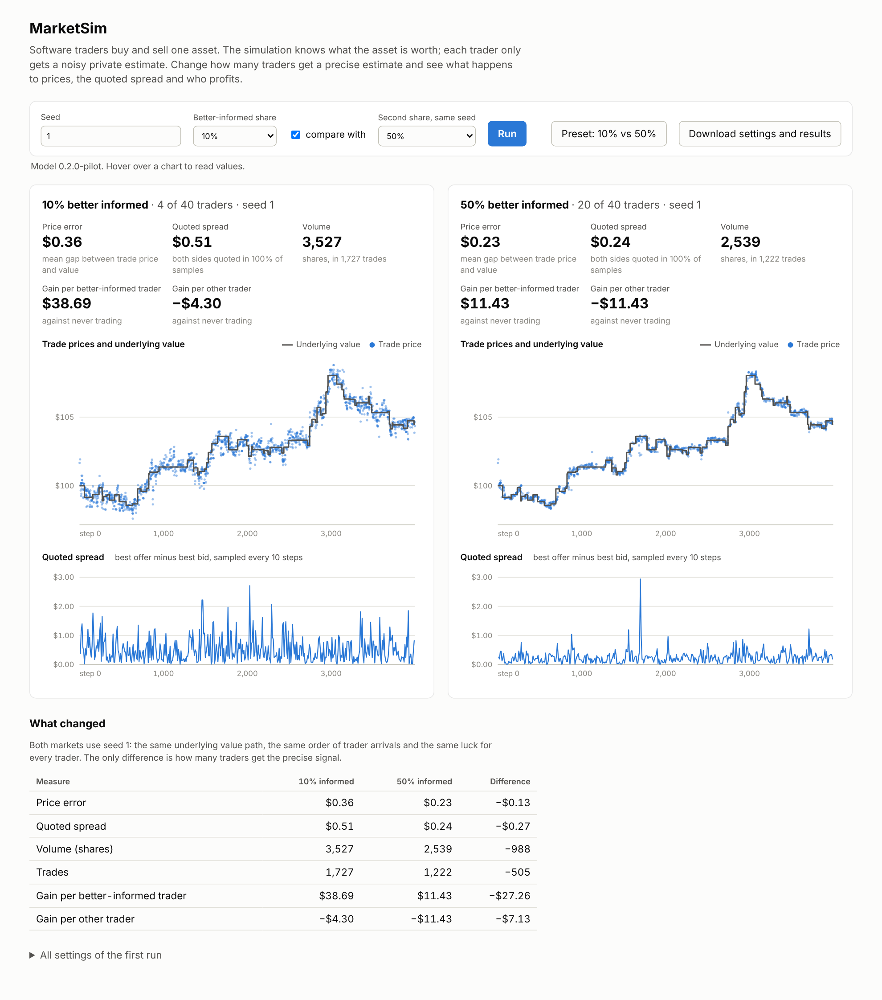
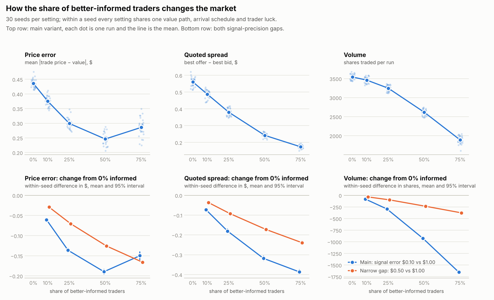
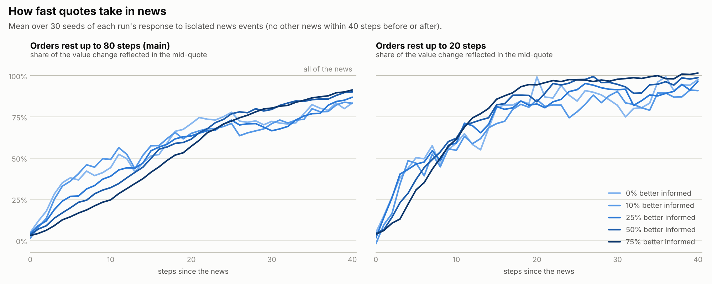

# MarketSimR


An artificial exchange where software traders buy and sell one asset. The simulation knows
the asset's underlying value. Each trader gets only a noisy private estimate of it, decides
what price it will accept, and sends an order to a limit order book. Comparing the prices
that result with the underlying value shows how information reaches a market.

**The question:** how does the proportion of better-informed traders affect price
accuracy, liquidity and trader profits?



The same market run twice on one seed: with 10% of traders well informed (left) trade
prices scatter around the underlying value, and with 50% (right) they hug it.

> **Status: pilot.** The engine, market model, first experiment and local dashboard run
> and are tested, and GitHub reinstalls and rechecks everything on each push. The market
> configuration was chosen by the build agent and has not been frozen.
> [docs/STATUS.md](docs/STATUS.md) lists what is done, what was checked and what is next.

## First result (pilot configuration)



Forty traders, 4,000 steps, 30 seeds. For each seed all five settings run on the same
value path, the same arrival schedule and the same per-trader luck, so each setting is
compared with the 0% baseline inside its own seed. Intervals are 95% t-intervals across
the 30 seeds.

| Better-informed share | Trade price error | Change from 0% [95% interval] | Mid-quote error | Change from 0% [95% interval] | Quoted spread | Volume (shares) |
| ---: | ---: | --- | ---: | --- | ---: | ---: |
| 0% | $0.44 | | $0.44 | | $0.56 | 3,543 |
| 10% | $0.38 | −$0.061 [−0.064, −0.057] | $0.36 | −$0.077 [−0.083, −0.072] | $0.49 | 3,461 |
| 25% | $0.30 | −$0.136 [−0.142, −0.131] | $0.26 | −$0.183 [−0.190, −0.177] | $0.38 | 3,248 |
| 50% | $0.25 | −$0.190 [−0.195, −0.184] | $0.17 | −$0.273 [−0.280, −0.267] | $0.24 | 2,616 |
| 75% | $0.29 | −$0.150 [−0.159, −0.141] | $0.15 | −$0.287 [−0.294, −0.280] | $0.17 | 1,888 |

Trade price error is the mean absolute gap between each trade price and the underlying
value at that step. Mid-quote error is the same gap for the midpoint of the best bid and
offer, taken on every step, so it does not depend on which trades happen. The asset is
worth about $100.

| Better-informed share | Trading gain per better-informed trader | Trading gain per other trader |
| ---: | --- | --- |
| 0% | unavailable (no such traders) | $0.00 |
| 10% | $45.01 [$42.55, $47.46] | −$5.00 [−$5.27, −$4.73] |
| 25% | $30.99 [$29.37, $32.60] | −$10.33 [−$10.87, −$9.79] |
| 50% | $12.04 [$11.16, $12.92] | −$12.04 [−$12.92, −$11.16] |
| 75% | $3.18 [$2.71, $3.64] | −$9.53 [−$10.93, −$8.12] |

Trading gain is final wealth minus what the same trader would have had by never trading,
with stock marked at the final underlying value. Gains sum to zero across traders.

What the pilot shows, in this model:

- **Quotes get more accurate all the way.** Mid-quote error falls from $0.44 to $0.15.
- **Trade prices stop improving after 50%, because of which trades happen.** Trades between
  two better-informed traders occur about $0.45 from the value at every share. Under the
  rules two such traders almost never disagree enough to trade unless news has left one
  of their quotes stale. These trades are under 2% of all trades up to a 25% share, about
  10% at 50% and a third at 75%, which pulls the average error back up.
- **Quoted spreads narrow and volume falls.** Fewer trades come from traders disagreeing
  about value by mistake.
- **Better-informed traders gain at the others' expense, and the gain per trader shrinks as
  their group grows:** $45 each when they are 10% of the market, $3 each at 75%.
- **Sensitivity check.** With a narrower gap in signal precision ($0.50 against $1.00
  instead of $0.10 against $1.00) every effect in the table has the same sign and is
  smaller, and trade price error falls all the way to 75% ($0.44 to $0.27).
- **Control.** With equal precision in both groups, relabelling who counts as "better
  informed" produced identical event logs in all 25 control runs.

### How fast prices take in news



For each isolated news event (no other news within 40 steps either side) the experiment
tracks how much of the value change the mid-quote has taken in. The half-life is the
number of steps until half is reflected.

| Better-informed share | Half-life, orders rest 80 steps (main) | Change from 0% [95% interval] | Half-life, orders rest 20 steps | Change from 0% [95% interval] |
| ---: | ---: | --- | ---: | --- |
| 0% | 9.1 steps | | 6.2 steps | |
| 10% | 9.6 | +0.2 [−2.2, +2.7] | 5.3 | −1.0 [−2.6, +0.6] |
| 25% | 12.4 | +3.1 [−0.2, +6.4] | 5.3 | −1.0 [−2.6, +0.6] |
| 50% | 15.9 | +6.8 [+3.7, +9.9] | 8.1 | +1.9 [+0.1, +3.7] |
| 75% | 18.2 | +9.0 [+5.8, +12.2] | 8.6 | +2.4 [+0.2, +4.6] |

- **In the main configuration, more better-informed traders means news reaches quotes more
  slowly at first.** The half-life roughly doubles between 0% and 75%. After 40 steps
  83% to 91% of the news is reflected at every share.
- **The likely cause is stale quotes.** In this model a resting order changes only when its
  owner next arrives or it expires. Better-informed traders' old quotes sit close together
  at the old value and hold the mid-quote there until they are taken or removed. When
  orders expire after 20 steps instead of 80, every market adjusts faster and most of
  the slowdown goes away.
- **These estimates are much noisier than the table above.** A run has about 14 isolated
  news events, the intervals are wide, and at 10% and 25% no difference is detectable.

Read all of this as properties of this model. The intervals measure variation across
seeds under one configuration; they say nothing about whether the assumptions below are
right.

## Run it

Requires Python 3.12 or newer.

```
python -m pip install -e ".[dev]"   # numpy, pandas, scipy, matplotlib and pytest
python -m pytest                    # all checks (89 tests, about 8 seconds)
python -m marketsim.dashboard       # the demo, at http://127.0.0.1:8000
python -m marketsim.example         # the first hand-worked case, step by step
python -m marketsim.run --seed 1 --informed-share 0.25 --trace-step 1
python -m marketsim.run --seed 1 --informed-share 0.25 --save results/scratch/run1
python -m marketsim.experiment      # regenerates results/informed_share (about 35 seconds)
python -m marketsim.experiment --check   # regenerates and compares with the saved results
python -m marketsim.benchmark       # times a fixed workload
```

`marketsim.experiment` rewrites the tables and charts in `results/informed_share/`. The
saved results were made with Python 3.13 and the library versions in
`requirements-tested.txt`.

On every push GitHub installs the project on a clean machine, runs the tests and the
worked example, and runs the `--check` command. It does this on Python 3.12 and 3.13 with
the newest libraries and once more with the exact tested versions
(`.github/workflows/tests.yml`).

## The dashboard

`python -m marketsim.dashboard` serves one page on your own computer. Pick a seed and a
better-informed share, optionally a second share on the same seed, and run. Each market
shows its measures, trade prices against the underlying value, and the quoted spread;
hovering a chart reads off values. "Preset: 10% vs 50%" loads a same-seed comparison, and
"Download settings and results" saves a JSON file whose `manifest.config` reproduces each
run.

The page gets its data from `run_simulation`, the same function the command line and the
experiment call, and a test checks that the dashboard's numbers equal the batch runner's.

Framework choice: Python's built-in web server plus plain JavaScript and SVG, so the demo
adds no dependency and nothing to install. Streamlit was the other candidate; it could not
be installed in the build session, so it could not have been checked.

## Benchmark

`python -m marketsim.benchmark` runs the default market (40 traders, 4,000 steps, 25%
informed) for seeds 0 to 4: 20,000 trader arrivals producing 34,965 logged events. Best of
three on Python 3.13.18, numpy 2.5.3, x86-64 Linux in the build container:

| | Time | Arrivals per second |
| --- | ---: | ---: |
| Invariant checks off | 0.28 s | about 70,000 |
| Invariant checks on after every operation | 1.88 s | about 10,600 |

The whole 475-run experiment takes about 35 seconds, so nothing has been optimized.

## How the market works

The full rules, each tied to the test that checks it, are in
[docs/model_rules.md](docs/model_rules.md). In short:

**Trading rules.** One asset, whole shares, prices in $0.01 ticks stored as integers. Limit
orders only. An incoming order trades against the best-priced resting orders on the other
side, oldest first at an equal price, at the resting order's price. Any remainder rests
until it is filled, cancelled or expired.

**Who sees what.** The underlying value is known to the simulation and to the analysis.
A trader sees its own noisy signal, its own account and the public best quotes, and
nothing else. The decision rule is a function of that view and receives no group label.
Better-informed traders differ only in the size of their signal error.

**How balances settle.** Traders have finite cash and shares, with no borrowing, short
selling or fees. A buy reserves cash at its limit price and a sell reserves its shares, so
a second order cannot reuse them. On a fill, cash and shares move at the trade price and
any excess reservation is released. Total cash and total shares never change.

**How traders decide.** Each arrival, a trader draws an inventory need. Being below target
makes it a buyer and above target a seller. It bids its signal minus a $0.20 margin, or
offers its signal plus the margin.

The first hand-worked case: a seller with five shares offers three at $10.00, and a buyer
with $50.00 bids for two at $10.10. `python -m marketsim.example` prints:

```
#3   t=0   order     #3 trader 1 sell 3 @ $10.00
#4   t=0   order     #4 trader 2 buy 2 @ $10.10
#5   t=0   trade     2 @ $10.00  buyer 2 (order #4), seller 1 (order #3)
#6   t=0   cancelled #3 trader 1, 1 unfilled
```

The buyer ends with $30.00 and two shares, the seller with $20.00 and three shares.

## Assumptions that limit interpretation

- **Traders do not learn from prices.** Less-informed traders act on their own noisy
  signal and ignore what the quotes imply, so they lose on average and keep trading. The
  model cannot show them protecting themselves by quoting wider or staying out.
- **Inventory need decides side and size, never price.** Equally informed traders with
  opposite needs mostly do not trade with each other.
- **Nobody takes a position beyond its inventory target,** so better-informed traders
  profit by trading on better terms, not by speculating without limit.
- **Resting orders are never refreshed.** A quote changes only when its owner next arrives
  or it expires, so even a well-informed trader leaves a stale quote in the book after
  news. The news-speed result above depends on this.
- **Depth at the best quote is almost always one order** (about three shares) with a
  one-cent tick and 40 traders, so that measure says little here.
- The configuration in `marketsim/config.py` is a pilot and none of its numbers has been
  calibrated to data.

## How the code is organized

| File | Role |
| --- | --- |
| `marketsim/exchange.py` | Order entry, price-time matching, settlement, cancellation, expiry |
| `marketsim/book.py` | The resting orders, ranked by price then arrival |
| `marketsim/accounts.py` | Cash, shares and reservations per trader |
| `marketsim/events.py` | The append-only event log that analysis reads |
| `marketsim/checks.py` | Accounting and book invariants, run after every operation in tests |
| `marketsim/config.py` | Every setting of a run, and the model version |
| `marketsim/world.py` | The value path, arrivals and per-trader luck, each from its own random stream |
| `marketsim/traders.py` | What a trader can see and the decision rule |
| `marketsim/simulation.py` | The one runner used by the command line, the experiment and the dashboard |
| `marketsim/metrics.py` | Per-run measures |
| `marketsim/news.py` | The news event study: how much of a value change prices reflect, step by step |
| `marketsim/experiment.py`, `charts.py` | The paired informed-share experiment and its charts |
| `marketsim/run.py`, `storage.py` | Run one market, trace a decision, export a run |
| `marketsim/dashboard.py`, `dashboard.html` | The local demo: a small server and one page |
| `marketsim/benchmark.py` | Times a fixed workload |
| `tests/reference.py` | An independent naive exchange used to cross-check the engine |

## Sources

No source has been used yet to motivate or calibrate the model, so none is cited. Papers
that bear directly on the assumptions above and are worth reading before the model is
revised: Glosten and Milgrom (1985) and Kyle (1985) on trading against better-informed
counterparties; Gode and Sunder (1993) on markets of traders with minimal intelligence;
Goettler, Parlour and Rajan (2009) on informed traders in limit order markets.
